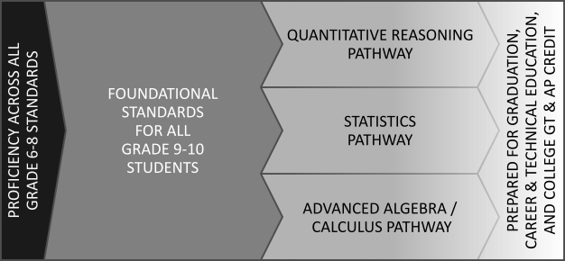
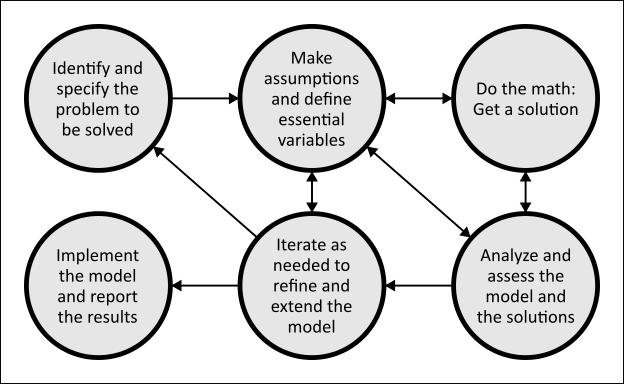
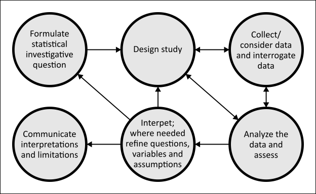

# High School

A standard is a "clear, measurable learning target for what a student should know or be able to do" (C.R.S. 22-7-1003(22)). The standards for high school mathematics are designed to provide students opportunities to learn rigorous, relevant mathematics for all four years of high school. High school mathematics should empower students to expand professional opportunities, to understand and critique the world, and to experience wonder, joy, and beauty (NCTM, 2018).

## Organization

Three major features organize the high school mathematics standards:

- The **mathematical domain(s)** of a standard’s content,
- The **mathematical and statistical process(es)** students are most likely to engage in for a standard, and
- The **mathematical pathway(s)** that channel students’ interests into a plan for high school and postsecondary success.

The organization of the high school mathematics standards into these three major features (domain, process, and pathway) is achieved using labels, marked with a 🏷️. Each standard is labeled with one or more items from each of the three major features. Clicking the label (when enabled on a web page) will filter the standards to show only those labeled with the selected label.

### Mathematical Domains

Colorado’s high school mathematics standards are labeled with at least one of four domains: algebra, functions, statistics, and geometry. Domains are not the same as courses; a rich mathematical experience should integrate content across multiple mathematical domains, regardless of how content is sorted into courses and credits.

**Algebra** (🏷️Algebra), as a high school topic of study, explores the arithmetic of expressions involving unknown or variable quantities. It is also a set of methods for identifying those unknowns and describing relationships between variables. **Prepared graduates** in the algebra domain should be able to demonstrate:

- Solving equations and inequalities, including those that require creativity to isolate a variable of interest, and
- Flexible and appropriate use of solution techniques for linear equations and inequalities, nonlinear equations and inequalities, and systems of equations and inequalities.

**Functions** (🏷️Function) describe special relationships between quantities. Understanding and working with functions requires not only algebraic skills for working with equations, tables, and graphs, but also a qualitative understanding of these relationships as mathematical objects. **Prepared graduates** in the functions domain should be able to demonstrate:

- Recognition of common function types and the mathematical behavior of those functions as they are interpreted and transformed, and
- Skill with multiple technologies to understand and apply functions to model and make sense of real-world phenomena.

**Statistics** (🏷️Statistics) involves understanding, explaining, and quantifying data, and using data to make predictions and informed decisions. Statistical literacy is a necessity in a data-rich world. Facility with large data sets, study designs, and statistical inference is a gateway to emerging career opportunities. **Prepared graduates** in the statistics domain should be able to demonstrate:

- Critical literacy with statistical data, data displays, and claims that describe and predict things about our world, and
- Skill with the tools and techniques of descriptive and basic inferential statistics to make claims and predictions with data of their own.

**Geometry** (🏷️Geometry) is the study of space, shape, size, and position. At the high school level, geometric measurement of increasingly complex two- and three-dimensional shapes is used to model the world and develop concepts in calculus. Geometry also provides a rich context for mathematical reasoning and proving. **Prepared graduates** in the geometry domain should be able to demonstrate:

- Application of geometric measurement to model shapes, surfaces, and volumes in the world, and
- Reasoning with the attributes of shapes to prove claims about those shapes, particularly as those shapes are subjected to geometric transformations.

### Mathematical and Statistical Processes and the Colorado Essential Skills

Student success in mathematics relies as much on mastery and confidence in a set of mathematical practices as it does on learning any particular content. To describe these practices, these standards are labeled with NCTM’s *Mathematical and Statistical Processes* (2024), which are 11 statements sorted into four groups:

**Modeling and Using Tools and Representations**

- 🏷️Model: Model with mathematics and statistics.
- 🏷️Contextualize: Decontextualize and recontextualize mathematical and statistical situations.
- 🏷️Tools: Use appropriate tools, including technology, strategically.
- 🏷️Representations: Use representations to examine multiple mathematical and statistical points of view.

**Explaining, Reasoning, and Proving**

- 🏷️Conjecture: Conjecture and reason inductively and deductively.
- 🏷️Communicate: Construct viable arguments and critique the reasoning of others.

**Seeing, Describing, and Generalizing Structure**

- 🏷️Structure: Look for and make use of structure.
- 🏷️Generalize: Look for and express regularity in repeated reasoning.

**Habits of a Productive Mathematical and Statistical Thinker**

- 🏷️Sensemaking: Make sense of problems and persevere in solving them.
- 🏷️Precision: Attend to precision in mathematical and statistical language and processes.
- 🏷️Tinker: Tinker productively with mathematical and statistical ideas and problems.

The Mathematical and Statistical Processes are a math-specific reflection of the *Colorado Essential Skills*, which are a set of durable, forward-looking skills that span all of Colorado’s content areas and grade levels. As described in statute, the Colorado Essential Skills “require a student to develop and demonstrate creativity and innovation skills; critical-thinking and problem-solving skills; communication and collaboration skills; social and cultural awareness; civic engagement; initiative and self-direction; flexibility; productivity and accountability; character and leadership; the ability to use information and communications technologies to find, evaluate, create, and communicate information; and other skills critical to preparing students for the twenty-first-century workforce and for active citizenship” (C.R.S. 22-7-1005).

The high school mathematics standards provide opportunities to integrate the Colorado Essential Skills (CES) and the Mathematical and Statistical Processes (MSP), especially in the following ways:

- *Creativity and innovation skills* (CES) are *habits of a productive mathematical and statistical thinker* (MSP), such as when someone makes sense of solution strategies to authentic problems when no prescribed solution process is given or known.
- *Critical thinking and problem-solving skills* (CES) are central to the study of mathematics and its application, especially in how mathematical thinkers use *models, tools, and representations* (MSP) and how they *see, describe, and generalize structure* (MSP).
- *Communication and collaboration skills* (CES) are needed when *explaining, reasoning, and proving* (MSP), especially as mathematics is integrated into new fields, used across diverse teams, and becomes part of our ability to be literate consumers of media and data.

**Prepared graduates** will engage in mathematical and statistical processes across lessons, units, and courses, and as they do, they learn how to participate in mathematical communities of practice. Although some content will lend itself more to some processes than others, students need repeated and intentional opportunities to engage with all 11 processes, and to make explicit connections between their activities and their development of the processes and the Colorado Essential Skills.

### Mathematics Pathways

A significant amount of high school mathematics content is **foundational** (🏷️Foundational) for every student. Learning this content prepares each student to pursue a wide range of opportunities. Learning foundational content should be the focus of every student in their first two years of high school. In the final two years of high school, students should complete one or more of the advanced mathematics pathways that aligns with their interests and post-secondary plans. Colorado’s high school mathematics standards include advanced content in three pathways: quantitative reasoning, statistics, and advanced algebra/calculus.

The **Quantitative Reasoning Pathway** (🏷️Quantitative Reasoning Pathway) offers opportunities for students who wish to pursue a deeper understanding of mathematical concepts through practical applications and using math as a tool for understanding the world. Students pursuing this pathway are expected to build on, integrate, and apply their existing mathematical understandings of quantity, algebra, statistics, and geometry, seeking pattern and order when faced with unfamiliar contexts. The quantitative reasoning pathway reflects the demand for habits of mind that center mathematical reasoning across all fields of work and life.

The **Statistics Pathway** (🏷️Statistics Pathway) offers opportunities for students who wish to develop skills for making sense of an increasingly data-driven world. Students pursuing this pathway are expected to address complexity and uncertainty by designing statistical studies and analyzing authentic, multivariable data. The statistics pathway reflects the growing demand for workers who can use modern tools and techniques to analyze data and make informed decisions.

The **Advanced Algebra/Calculus Pathway** (🏷️Advanced Algebra/Calculus Pathway) offers opportunities for students who wish to develop theoretical and applied knowledge about functions, algebraic structures, rates of change, accumulation, and geometry. Students pursuing this pathway are expected to be fluent in algebraic methods and concepts. The advanced algebra/calculus pathway reflects the knowledge needed in many business fields or a career in science, technology, engineering, or mathematics (STEM).

_Two years of foundational mathematics plus pathways, blurring into postsecondary opportunities._

**Prepared graduates** will be college- and career-ready by completing one or more of the three advanced pathways. This means they are prepared to successfully earn credit in one or more of Colorado’s college-level, Guaranteed Transfer (GT) courses, either in high school through dual/concurrent enrollment or upon entering college.

## Points of Emphasis

Two topics deserve extra emphasis in these standards for their ubiquity throughout high school mathematics and their potential to improve teaching and learning. These two topics, modeling and technology, are represented in the mathematical and statistical processes (🏷️Model and 🏷️Tools), but additional emphasis is placed here to clarify the standards and encourage thoughtful use in the classroom.

### Mathematical and Statistical Modeling

High school mathematics should prepare students to ask questions, think critically, and apply their knowledge to problems and ideas that matter (NCTM, 2024). This preparation involves giving students opportunities to engage in *modeling*, which is “a process that uses mathematics to represent, analyze, make predictions, or otherwise provide insight into real-world phenomena” (COMAP and SIAM, 2016).

Modeling can be seen as a *mathematical* cycle, focusing on the application of algebra, functions, geometry, and measurement, or as a *statistical* cycle, focusing on the application of statistics, probability, or tools and methods from data science. In both cases, the early stages involve identifying a problem, asking questions, and applying some mathematics or statistics. In both cycles, the later stages involve analyzing and assessing the model's outputs, refining questions, iterating on the process, and reporting results.

_The Mathematical Modeling Cycle (COMAP and SIAM, 2016; NCTM, 2024)._

_The Statistical Modeling Cycle (ASA, 2020; NCTM, 2024)._

Engaging in mathematical or statistical modeling should go beyond solving a “real-world” word problem, especially at the high school level and above. Word problems usually give students the information they need to answer a question, whereas authentic modeling in the real world requires the problem solver to ask their own questions, determine what information is available, and decide when the model is good enough to yield a useful solution. Authentic modeling can take weeks or months of work; in the high school classroom, when facilitated by a teacher who balances learning goals with an understanding of the messiness of authentic modeling, a rich modeling task could take multiple hours over multiple class periods. Authentic modeling is also more than an opportunity to apply knowledge and skills already learned and practiced. Modeling tasks should motivate students to learn more mathematics by providing a context for developing additional knowledge, so that their models become more accurate and are better representations of the real-world phenomena under examination.

### Use of Technology

Technology is an essential tool in the world, the workplace, and the classroom. Students must develop the ability to determine when and how to use technology effectively, and to evaluate its efficiency and appropriateness for a given task. For this reason, exposure to a variety of technological tools is a necessary component of mathematical practice, combined with instruction that helps students understand which tool to use and when.

The high school standards address technology in one of three ways:

- **The standard says, “use technology.”** For these standards, technology use is expected. Students are not required to demonstrate mastery without technology.
- **The standard mentions technology, such as “with and without technology.”** For these standards, technology use is expected. However, students should also be able to demonstrate mastery without technology.
- **The standard does not mention technology.** For these standards, technology use is not required, and students should demonstrate mastery without technology. However, the 🏷️Tools process still generally applies, which asks students to “use appropriate tools, including technology, strategically.”

Technology is a subset of all the tools (analog and digital) that a student of mathematics may use. In mathematics classrooms, technology generally falls into two categories: (1) mathematical action technologies, which perform mathematical tasks and support mathematical sensemaking, and (2) conveyance technologies, which transmit and/or receive information and are not specific to mathematics (Dick & Hollebrands, 2011). When technology is referenced in the math standards, the intent is for students to engage with mathematical action technologies. Mathematical action technologies to use across the high school domains include:

- Artificial intelligence (AI) programs 🏷️Algebra 🏷️Function 🏷️Statistics 🏷️Geometry
- Computer algebra systems (CAS) 🏷️Algebra 🏷️Function
- Computer simulations and applets 🏷️Algebra 🏷️Function 🏷️Statistics 🏷️Geometry
- Data analysis software 🏷️Statistics
- Dynamic geometry software 🏷️Geometry
- Graphing applications (e.g., graphing calculators, online graphing programs) 🏷️Algebra 🏷️Function 🏷️Statistics 🏷️Geometry
- Spreadsheet applications 🏷️Function 🏷️Statistics
- Virtual manipulatives 🏷️Algebra 🏷️Function 🏷️Statistics 🏷️Geometry
- Virtual reality (VR) applications 🏷️Algebra 🏷️Function 🏷️Statistics 🏷️Geometry

The quality of a technology is no better than the quality of its use. In general, teachers and students should be mindful of how using technology enhances or inhibits students' abilities to engage in the mathematical and statistical processes. For example:

- Solving some quadratic equations by factoring can help students look for and make use of structure, but using a computer algebra system can relieve the computational burden of solving many quadratic equations as they model with mathematics.
- Drawing figures by hand as part of a visual pattern can help students look for and express regularity in repeated reasoning, while using a spreadsheet can help students productively tinker with recursive and explicit functions that describe the pattern.
- Relying on artificial intelligence to analyze data could reduce or eliminate student engagement in multiple practices, but asking it to tutor students in writing code for data analysis software could help students make sense of problems and persevere in solving them.

In some cases, the value of using technology lies not only in the ways it enhances the learning of mathematics but also in the skill of learning to use the technology itself. Learning how to use spreadsheets for computation and data analysis, for example, is a skill with many benefits both within a math classroom and beyond. In contrast, a specialized computer simulation that demonstrates variability in repeated sampling may have great value for learning statistical principles but may not be useful on its own for performing a statistical analysis.

------------------------------------------------------------------------

## Draft High School Mathematics Standards

Filter by Label:

**Domain Labels**

- 🏷️Algebra
- 🏷️Function
- 🏷️Statistics
- 🏷️Geometry

**Pathways Labels**

- 🏷️Foundational
- 🏷️Quantitative Reasoning Pathway
- 🏷️Statistics Pathway
- 🏷️Advanced Algebra/Calculus Pathway

**Mathematical and Statistical Process Labels**

Modeling and Using Tools and Representations

- 🏷️Model
- 🏷️Contextualize
- 🏷️Tools
- 🏷️Representations

Explaining, Reasoning, and Proving

- 🏷️Conjecture
- 🏷️Communicate

Seeing, Describing, and Generalizing Structure

- 🏷️Structure
- 🏷️Generalize

Habits of a Productive Mathematical and Statistical Thinker

- 🏷️Sensemaking
- 🏷️Precision
- 🏷️Tinker

### HS.1. Understanding Expressions and Mathematical Objects

Expressions are foundational mathematical objects that represent quantities and relationships. In high school, students deepen their understanding of expressions as components of equations, inequalities, and functions, and use these distinctions to clarify how different algebraic representations convey meaning. Through this study of structure and representation, students develop greater precision, flexibility, and sensemaking that support advanced mathematical pathways.

1. Recognize that expressions are components of equations and inequalities. 🏷️Algebra 🏷️Structure 🏷️Precision 🏷️Foundational
2. Articulate that an expression is a quantity while equations and inequalities are relationships of expressions, and demonstrate through proper use of these representations. 🏷️Algebra 🏷️Communicate 🏷️Structure 🏷️Foundational
3. Rewrite expressions to reveal information about the expression. 🏷️Algebra 🏷️Structure 🏷️Tinker 🏷️Foundational
4. Analyze expressions that represent real-world quantities, explaining what each term, factor, or component represents in the situation. 🏷️Algebra 🏷️Contextualize 🏷️Precision 🏷️Foundational
5. Rewrite expressions involving radicals and rational exponents using the properties of exponents. Extend a pattern to demonstrate how the meaning of rational exponents follows from extending the properties of integer exponents to rational exponents and related radicals. 🏷️Algebra 🏷️Structure 🏷️Generalize 🏷️Foundational
6. Recognize that polynomials form a system analogous to the integers. Apply this understanding to add, subtract, and multiply polynomials. 🏷️Algebra 🏷️Precision 🏷️Foundational
7. Know and apply the Binomial Theorem for the expansion of $n$ powers of $x$ and $y$ for a positive integer $n$ no greater than 7, with coefficients determined by Pascal’s Triangle. 🏷️Algebra 🏷️Sensemaking 🏷️Precision 🏷️Advanced Algebra/Calculus Pathway
8. Rewrite simple rational expressions in different forms using inspection, division, and technology. 🏷️Algebra 🏷️Tools 🏷️Structure 🏷️Advanced Algebra/Calculus Pathway
9. Add, subtract, multiply, and divide rational expressions. 🏷️Algebra 🏷️Structure 🏷️Precision 🏷️Advanced Algebra/Calculus Pathway
10. Articulate how equivalent expressions describe the same quantitative relationship in different ways. 🏷️Algebra 🏷️Conjecture 🏷️Sensemaking 🏷️Quantitative Reasoning Pathway
11. Use the relation $i^2 = -1$ and the commutative, associative, and distributive properties to add, subtract, and multiply complex numbers. 🏷️Algebra 🏷️Structure 🏷️Precision 🏷️Advanced Algebra/Calculus Pathway

### HS.2. Connecting to Functions

Arithmetic and geometric sequences help students connect ordered pairs to functions as unified objects with distinct behaviors. Explicit links are made between arithmetic sequences and linear functions, and between geometric sequences and exponential functions. Students making these connections deepen their functional thinking, especially when they apply it to authentic contexts.

1. Investigate arithmetic sequences with and without technology and represent related patterns with an expression. 🏷️Algebra 🏷️Tools 🏷️Generalize 🏷️Foundational
2. Articulate how arithmetic sequences are related to linear functions. Describe how arithmetic sequences are discrete and linear functions are continuous. 🏷️Algebra 🏷️Function 🏷️Communicate 🏷️Generalize 🏷️Foundational
3. Investigate geometric sequences with and without technology and represent related patterns with an expression. 🏷️Algebra 🏷️Tools 🏷️Generalize 🏷️Foundational
4. Articulate how geometric sequences are related to exponential functions. Describe how geometric sequences are discrete and exponential functions are continuous. 🏷️Algebra 🏷️Function 🏷️Communicate 🏷️Generalize 🏷️Foundational
5. Investigate and apply the formula for the sum of the first $n$ terms of an arithmetic series in an authentic context and with technology. 🏷️Algebra 🏷️Conjecture 🏷️Generalize 🏷️Quantitative Reasoning Pathway 🏷️Advanced Algebra/Calculus Pathway
6. Investigate and apply the formula for the sum of a finite geometric series when the common ratio is not one, in an authentic context and with technology. 🏷️Algebra 🏷️Conjecture 🏷️Generalize 🏷️Quantitative Reasoning Pathway 🏷️Advanced Algebra/Calculus Pathway

### HS.3. Making Meaning of Solutions and Solving Methods

Students build on previous learning with solving equations and inequalities to understand the meaning of what solutions represent and how they relate to algebraic expressions, graphs, and contextual situations. They interpret solution sets in relation to the quantities and relationships being represented and use this understanding to choose and justify appropriate solving methods. These ideas extend to quadratic equations, including those with non-real solutions, and interpreting how these solutions relate to features of graphs.

1. Describe relationships and make connections between algebraic representations, the related graph, and its solution set for equations, inequalities, and systems. 🏷️Algebra 🏷️Communicate 🏷️Sensemaking 🏷️Foundational
2. Solve linear equations and inequalities in one variable by graphing with and without technology to make connections between the equation or inequality and the solution(s). 🏷️Algebra 🏷️Representations 🏷️Sensemaking 🏷️Foundational
3. Solve quadratic equations using multiple methods. Methods include graphing and identifying $x$-intercepts by hand and with technology, factoring, and using the Quadratic Formula. Make connections between the equation and the solution(s) and explore when real solutions exist. 🏷️Algebra 🏷️Tools 🏷️Sensemaking 🏷️Foundational
4. Solve systems of linear equations in authentic contexts, algebraically and graphically, solving simple cases by hand and more complicated systems with technology. Articulate that a solution, when it exists, is represented by the points of intersection on a graph or is an ordered pair that makes both equations true. 🏷️Algebra 🏷️Tools 🏷️Representations 🏷️Foundational
5. Solve systems consisting of a linear equation and a nonlinear equation in two variables algebraically or graphically, solving simple cases by hand and more complicated cases with technology. Articulate that a solution, when it exists, is represented by the points of intersection on a graph or is an ordered pair that makes both equations true. 🏷️Algebra 🏷️Tools 🏷️Representations 🏷️Foundational
6. Identify the number of solutions to a system of linear equations without solving or using technology. 🏷️Algebra 🏷️Conjecture 🏷️Structure 🏷️Foundational
7. Solve systems of linear inequalities graphically with and without technology. Articulate that a solution, when it exists, is represented by the region of intersection that makes both inequalities true. 🏷️Algebra 🏷️Tools 🏷️Representations 🏷️Foundational
8. Determine the total number of roots of a polynomial using the Fundamental Theorem of Algebra. 🏷️Algebra 🏷️Communicate 🏷️Generalize 🏷️Advanced Algebra/Calculus Pathway
9. Identify zeros of polynomials when suitable factorizations are available. Use the zeros to construct a rough graph of the function defined by the polynomial without technology. 🏷️Algebra 🏷️Representations 🏷️Structure 🏷️Advanced Algebra/Calculus Pathway
10. Solve rational and radical equations in one variable, and give examples showing how extraneous solutions may arise. 🏷️Algebra 🏷️Sensemaking 🏷️Precision 🏷️Advanced Algebra/Calculus Pathway
11. Explain the inverse relationship between exponents and logarithms. Express the solution to an exponential equation as a logarithm and evaluate it using technology. 🏷️Algebra 🏷️Tools 🏷️Structure 🏷️Advanced Algebra/Calculus Pathway

### HS.4. Modeling Authentic Contexts with Equations, Inequalities, and Systems

Expressions, equations, and inequalities can be used to analyze and make predictions about relationships and changing quantities. They support mathematical modeling in authentic problem contexts involving linear, quadratic, and exponential situations, as well as vectors. Students create and interpret models, make assumptions explicit, and communicate results in relation to the context.

1. Create linear, quadratic, and exponential equations and linear inequalities and use them to solve problems in authentic contexts. 🏷️Algebra 🏷️Model 🏷️Contextualize 🏷️Foundational
2. Model authentic contexts by describing and using constraints with equations, inequalities, and systems. Interpret solution sets as viable or nonviable based on the context. 🏷️Algebra 🏷️Model 🏷️Contextualize 🏷️Foundational
3. Build on existing understanding of quantities, ratios, rates, proportions, and percentages to investigate and solve problems in authentic contexts. 🏷️Algebra 🏷️Model 🏷️Representations 🏷️Quantitative Reasoning Pathway
4. Use functional models to solve and communicate about contextual financial questions such as credit card debt, installment savings, amortization schedules, mortgage and other loan scenarios. 🏷️Algebra 🏷️Model 🏷️Sensemaking 🏷️Quantitative Reasoning Pathway
5. Analyze and critique mathematical models and describe their limitations. Develop models to estimate solutions to contextual questions, identify patterns, and identify how changing parameters affect the results. 🏷️Algebra 🏷️Model 🏷️Generalize 🏷️Quantitative Reasoning Pathway
6. Reason about real numbers in context and use dimensional analysis as a way to understand problem situations and mathematical models. Determine when approximations are appropriate and when exact calculations are necessary. 🏷️Algebra 🏷️Model 🏷️Precision 🏷️Quantitative Reasoning Pathway
7. Apply algebraic properties to rewrite formulas to highlight a quantity of interest in an authentic modeling context. 🏷️Algebra 🏷️Model 🏷️Structure 🏷️Foundational
8. Justify when lines are parallel or perpendicular using slope relationships and apply this reasoning to create equations that model particular conditions or contexts. 🏷️Algebra 🏷️Model 🏷️Contextualize 🏷️Foundational

### HS.5. Describing Function Relationships

Functions describe special relationships between quantities through two complementary perspectives: correspondence, where each input maps to exactly one output, and covariation, where changes in one quantity drive changes in another. Understanding both perspectives deepens students' grasp of how functions model real-world phenomena. Students think flexibly about functions by considering both how inputs map to outputs and how quantities change together.

1. Explain that a function is a correspondence from one set (called the domain) to another set (called the range) that assigns to each element of the domain exactly one element of the range. Use the notation $y = f(x)$ to mean that $y$ is a function of $x$. 🏷️Function 🏷️Communicate 🏷️Sensemaking 🏷️Foundational
2. Explain that a function is a co-varying relationship between quantities that change together. For $y = f(x)$, describe how the values of $x$ and $y$ change together. 🏷️Function 🏷️Communicate 🏷️Sensemaking 🏷️Foundational
3. Model authentic contexts with functions and describe the correspondence and covariation using the context. 🏷️Function 🏷️Model 🏷️Contextualize 🏷️Foundational
4. Use technology to visualize functions and explore how changes in one quantity affect the other. 🏷️Function 🏷️Tools 🏷️Conjecture 🏷️Foundational
5. Model authentic situations with functions using technology. Identify and interpret relationships between quantities in terms of correspondence and covariation. 🏷️Function 🏷️Tools 🏷️Contextualize 🏷️Foundational

### HS.6. Representing Functions in Different Ways

Functions can be represented in multiple forms: equations, graphs, tables, diagrams, and verbal descriptions. Each form offers unique ways to visualize, describe, and solve problems. Different representations of the same function reveal different features and insights about the relationship between variables. Students select and fluently move between different representations of functions to deepen understanding and solve varied problems.

1. Represent functions using equations, graphs, tables, diagrams, and verbal descriptions with and without technology. Describe relationships between different representations of the same function. 🏷️Function 🏷️Representations 🏷️Communicate 🏷️Foundational
2. Given one representation for a function, create one or more different representations of that function. 🏷️Function 🏷️Representations 🏷️Foundational
3. Represent authentic relationships using function notation, evaluate these functions for specific inputs in their domains, and interpret statements that use function notation in terms of their contexts. 🏷️Function 🏷️Contextualize 🏷️Precision 🏷️Foundational
4. Explore the effects of varying the parameters of functions using technology, including different functional representations and correspondence and covariation perspectives. 🏷️Function 🏷️Contextualize 🏷️Tools 🏷️Foundational
5. Given a situation modeled by contextual data, use technology to visualize the data, explore different potential functions to model the data, analyze the potential function models, and determine the best model to represent the data. Justify the selected function model. 🏷️Function 🏷️Tools 🏷️Tinker 🏷️Quantitative Reasoning Pathway 🏷️Statistics Pathway

### HS.7. Comparing Within and Across Function Families

Functions can be rewritten in equivalent symbolic forms using properties of equality to reveal and explain specific function features visible in graphical representations. Functions are organized into families, where functions in the same family share the same relationship between variables, including foundational families like linear, exponential, and quadratic. Students rewrite functions in different forms and classify functions by family to understand how symbolic forms connect to contextual interpretations and graphs.

1. Describe linear, exponential, and quadratic functions in terms of correspondence in their input and output values. 🏷️Function 🏷️Communicate 🏷️Foundational
2. Describe linear, exponential, and quadratic functions in terms of covariation in their input and output values. 🏷️Function 🏷️Sensemaking 🏷️Foundational
3. Describe absolute value, logarithmic, polynomial, rational, periodic, piecewise defined, radical, and trigonometric functions in terms of correspondence in their input and output values. 🏷️Function 🏷️Structure 🏷️Advanced Algebra/Calculus Pathway
4. Describe absolute value, logarithmic, polynomial, rational, periodic, piecewise defined, radical, and trigonometric functions in terms of covariation in their input and output values. 🏷️Function 🏷️Structure 🏷️Advanced Algebra/Calculus Pathway
5. Describe linear, exponential, and quadratic functions in terms of the absolute change in the input values and in the output values. 🏷️Function 🏷️Communicate 🏷️Precision 🏷️Foundational
6. Compare the rates of change of linear, exponential, and quadratic functions. 🏷️Function 🏷️Communicate 🏷️Precision 🏷️Foundational
7. Calculate and interpret average rates of change for linear, exponential, and quadratic functions. 🏷️Function 🏷️Precision 🏷️Foundational
8. Calculate and interpret average rates of change for absolute value, logarithmic, polynomial, rational, periodic, piecewise defined, radical, and trigonometric functions. 🏷️Function 🏷️Precision 🏷️Advanced Algebra/Calculus Pathway
9. Identify and compare key features of linear, exponential, and quadratic functions using equations, graphs, tables, diagrams, and verbal descriptions with and without technology. Key features include intercepts, intervals where the function is increasing, decreasing, positive or negative; relative maxima and minima; and symmetries. Make explicit connections between representations of the same function. 🏷️Function 🏷️Structure 🏷️Foundational
10. Identify and compare key features of absolute value, logarithmic, polynomial, rational, periodic, piecewise defined, radical, and trigonometric functions using equations, graphs, tables, diagrams, and verbal descriptions with and without technology. Key features include intercepts, intervals where the function is increasing, decreasing, positive or negative; relative maxima and minima; symmetries; periodicity; and end behavior. Make explicit connections between representations of the same function. 🏷️Function 🏷️Structure 🏷️Advanced Algebra/Calculus Pathway
11. Make generalizations about the form and behavior of linear, exponential, and quadratic functions. 🏷️Function 🏷️Generalize 🏷️Foundational
12. Make generalizations about the form and behavior of absolute value, logarithmic, polynomial, rational, periodic, piecewise defined, radical, and trigonometric functions. 🏷️Function 🏷️Structure 🏷️Generalize 🏷️Advanced Algebra/Calculus Pathway
13. Fit and compare models to real-world data using technology. Interpret parameters and justify which model best captures observed trends. Propose and test refinements to improve the model. 🏷️Function 🏷️Tools 🏷️Quantitative Reasoning Pathway 🏷️Statistics Pathway
14. Determine and represent which function family best models an authentic situation given by a set of data using technology. 🏷️Function 🏷️Statistics 🏷️Tools 🏷️Structure 🏷️Quantitative Reasoning Pathway 🏷️Statistics Pathway

### HS.8. Transforming Functions to Create New Functions

Transforming and combining functions connects algebraic changes to geometric changes on a graph, helping students understand what is preserved and what changes under different transformations. Through translations, reflections, stretches, and compressions, students track how points move and develop intuition about function behavior. Students apply transformations, explore compositions and inverses, and create new functions from existing ones.

1. Describe the relationship between a function and its inverse and explain that the range of the function is the domain of its inverse, and the domain of the function is the range of its inverse. 🏷️Function 🏷️Communicate 🏷️Foundational
2. For linear, exponential, and quadratic functions, identify the effect on the graph of $y = f(x)$ by substituting $f(x)$ with $af(x)$, $f(bx)$, $f(x + c)$, $f(x) + d$, and/or combinations of each for specific values of $a$, $b$, $c$, $d$. Determine the value of $a$, $b$, $c$, and/or $d$ given the graphs. 🏷️Function 🏷️Model 🏷️Representations 🏷️Foundational
3. For absolute value, logarithmic, polynomial, rational, periodic, piecewise defined, radical, and/or trigonometric functions, identify the effect on the graph of $y = f(x)$ by substituting $f(x)$ with $af(x)$, $f(bx)$, $f(x + c)$, $f(x) + d$ and/or combinations of each for specific values of $a$, $b$, $c$, $d$. Determine the value of $a$, $b$, $c$, and/or $d$ given the graphs. 🏷️Function 🏷️Model 🏷️Representations 🏷️Advanced Algebra/Calculus Pathway
4. Determine how points on the graph of a function change under transformations with and without technology. Describe how translations, reflections, stretches, and compressions affect the graph and the coordinates of points of interest. Identify which properties of the function are preserved and which are changed. 🏷️Function 🏷️Communicate 🏷️Foundational
5. Use arithmetic operations and/or function composition to combine functions to form a new function. Given $f(x)$ and $g(x)$, determine $f(x) + g(x)$, $f(x) - g(x)$, $f(x) \times g(x)$, $f(x) / g(x)$, and $f(g(x))$. Use technology to represent these function combinations. 🏷️Function 🏷️Tools 🏷️Representations 🏷️Advanced Algebra/Calculus Pathway
6. Given a combination of functions, $f(x) + g(x)$, $f(x) - g(x)$, $f(x) \times g(x)$, $f(x) / g(x)$, or $f(g(x))$, identify possible component parts $f(x)$ and $g(x)$, with and without technology. 🏷️Function 🏷️Tools 🏷️Representations 🏷️Advanced Algebra/Calculus Pathway
7. Use technology to demonstrate the relationship between inverse functions and their compositions. 🏷️Function 🏷️Tools 🏷️Advanced Algebra/Calculus Pathway
8. Use technology to transform a functional model of an authentic context in response to a change in conditions. 🏷️Function 🏷️Contextualize 🏷️Tools 🏷️Quantitative Reasoning Pathway 🏷️Statistics Pathway 🏷️Advanced Algebra/Calculus Pathway

### HS.9. Organizing, Summarizing, and Interpreting Data

Data can be collected, displayed, summarized, and interpreted to identify patterns, relationships, and departures from expectations. Categorical data are described using relative frequencies, comparative language, and features of visual representations. Quantitative data are characterized by the shape of the distribution, measures of center and spread, and unusual features. Students compare distributions using both numerical summaries and visual displays to draw meaningful conclusions from data.

1. Classify data that arises from a context as univariate or bivariate and classify whether the variable(s) associated with a set of data are categorical or quantitative (discrete or continuous). 🏷️Statistics 🏷️Contextualize 🏷️Precision 🏷️Foundational
2. Create visualizations to organize data according to its classification, using appropriate technology. Visualizations must include pie charts, side-by-side boxplots, histograms, stem plots, two-way frequency tables, scatterplots, and segmented bar graphs. 🏷️Statistics 🏷️Tools 🏷️Representations 🏷️Foundational
3. Summarize the characteristics of a data display in context, using technology to calculate appropriate summary statistics that describe the data set. 🏷️Statistics 🏷️Tools 🏷️Precision 🏷️Foundational
4. Justify data-based conclusions about one or two sets of data, using a display or summary statistics as evidence. 🏷️Statistics 🏷️Communicate 🏷️Precision 🏷️Foundational
5. Critique data-based claims and visualizations for potential misleading features, ethical implications, and limitations. 🏷️Statistics 🏷️Communicate 🏷️Sensemaking 🏷️Foundational
6. Create and present data narratives that communicate findings transparently, including sources of uncertainty and contextual constraints. 🏷️Statistics 🏷️Conjecture 🏷️Precision 🏷️Foundational
7. Calculate the percentile and standard score for an individual data point as it compares to a larger group and interpret those in context. 🏷️Statistics 🏷️Contextualize 🏷️Precision 🏷️Foundational
8. Model an authentic context with a normal distribution using the mean and standard deviation. Interpret the model to solve problems related to the relative position of data points using the empirical rule and describe the results in context. 🏷️Statistics 🏷️Model 🏷️Contextualize 🏷️Foundational
9. Build on existing understanding of measures of center and variability to interpret, compare, and evaluate claims based on such summaries for problems in authentic contexts. 🏷️Statistics 🏷️Model 🏷️Communicate 🏷️Quantitative Reasoning Pathway
10. Model an authentic context with a normal or binomial distribution using the mean and standard deviation. With technology, interpret the model to solve problems related to the relative position of any data points, using calculations appropriate to the distribution, and describe the results in context. 🏷️Statistics 🏷️Model 🏷️Contextualize 🏷️Statistics Pathway
11. Justify data-based conclusions about multiple sets of data using a display or summary statistics as evidence. 🏷️Statistics 🏷️Communicate 🏷️Precision 🏷️Quantitative Reasoning Pathway 🏷️Statistics Pathway

### HS.10. Modeling Bivariate Data

Analyzing relationships between two variables allows students to formalize associations, compare groups, and interpret trends across contexts. Students consider when an observed association may or may not suggest a causal relationship, recognizing the importance of study design. Models created from bivariate data support prediction and interpretation, and students evaluate these models by examining their implications, limitations, and the error associated with their predictions.

1. Represent the relationship between two quantitative variables with a linear regression model, using appropriate technology. Interpret key features of the regression model, including the correlation coefficient, in authentic contexts. 🏷️Statistics 🏷️Model 🏷️Contextualize 🏷️Foundational
2. Calculate and interpret predicted values and residuals from a linear regression. Identify restrictions on the domain that produce reliable predictions, and explain how extrapolation makes predictions less reliable. 🏷️Statistics 🏷️Representations 🏷️Generalize 🏷️Foundational
3. Create and interpret residual plots to formally assess the appropriateness of a linear model. 🏷️Statistics 🏷️Tools 🏷️Generalize 🏷️Statistics Pathway
4. Choose an appropriate quadratic or exponential model for a nonlinear data set using technology. 🏷️Statistics 🏷️Tools 🏷️Tinker 🏷️Foundational
5. Describe the limitations of applying a regression model to a set of data. Identify potential confounding variables in authentic contexts. 🏷️Statistics 🏷️Representations 🏷️Sensemaking 🏷️Foundational
6. Differentiate between correlation and causation. 🏷️Statistics 🏷️Communicate 🏷️Precision 🏷️Foundational
7. Use data to develop, validate, and iteratively refine a mathematical model arising from a linear, exponential, or quadratic context. 🏷️Statistics 🏷️Model 🏷️Quantitative Reasoning Pathway

### HS.11. Drawing Inferences

Statistical inference enables students to draw conclusions about authentic populations by using data from samples. By integrating ideas from simulation and probability, students describe the confidence they can place in an inference and quantify the potential error in their conclusions. Students learn to evaluate claims, recognize the role of variability, and understand both the power and the limitations of making generalizations from sample data.

1. Explain whether a result or estimate for a population seems reasonable or unusual when compared to what might occur due to random chance. 🏷️Statistics 🏷️Communicate 🏷️Tinker 🏷️Foundational
2. Employ simulation models for random sampling to estimate a margin of error, determine approximate sampling distributions, and informally evaluate statistical significance. 🏷️Statistics 🏷️Tools 🏷️Sensemaking 🏷️Foundational
3. Analyze and use statistical evidence to evaluate results and to answer statistical investigative questions about one population parameter or the difference between two population parameters. Justify statistical reasoning and results in written and visual formats. 🏷️Statistics 🏷️Conjecture 🏷️Communicate 🏷️Statistics Pathway
4. Describe a sampling distribution for a population parameter by identifying the mean and standard deviation that would be generated by repeated samples of size $n$. Articulate how the size of the sample impacts the variability in the sampling distribution of a sample statistic. 🏷️Statistics 🏷️Tools 🏷️Structure 🏷️Statistics Pathway
5. Represent the distribution of sample averages as a normal distribution by applying the central limit theorem. 🏷️Statistics 🏷️Representations 🏷️Generalize 🏷️Statistics Pathway
6. Calculate and interpret $p$-values to evaluate results and to answer statistical questions about a population parameter. 🏷️Statistics 🏷️Tools 🏷️Precision 🏷️Statistics Pathway
7. Interpret a confidence level as a success rate for capturing a population parameter. Calculate and interpret a confidence interval as an estimate of a population parameter. 🏷️Statistics 🏷️Tools 🏷️Generalize 🏷️Statistics Pathway
8. Justify a claim using a decision based on a significance test or a confidence interval. 🏷️Statistics 🏷️Communicate 🏷️Sensemaking 🏷️Statistics Pathway

### HS.12. Designing Studies

Surveys, observational studies, and experiments are common methods of data collection that students encounter in many aspects of daily life. Understanding the differences among these designs and the role of randomization in their planning and execution is essential for interpreting results and evaluating the strength of the evidence. Through this work, students develop the critical thinking needed to assess how data are generated and what conclusions can be reliably drawn.

1. Distinguish between sample surveys, experiments, and observational studies. Choose an appropriate data-collection method to answer an investigative question of interest. 🏷️Statistics 🏷️Model 🏷️Sensemaking 🏷️Foundational
2. Articulate what constitutes good practice in designing a sample survey, an experiment, and an observational study. 🏷️Statistics 🏷️Model 🏷️Communicate 🏷️Foundational
3. Identify potential sources of bias and confounding variables in a study. Explain the implications of bias and confounding variables in the interpretation of the results. 🏷️Statistics 🏷️Communicate 🏷️Precision 🏷️Foundational
4. Explain that the purpose of randomly assigning subjects to experimental treatment groups is to ensure the treatment groups are as similar to each other as possible. 🏷️Statistics 🏷️Communicate 🏷️Generalize 🏷️Foundational
5. Describe the role of randomization in relation to the scope and validity of statistical inferences. 🏷️Statistics 🏷️Contextualize 🏷️Communicate 🏷️Statistics Pathway
6. Design a completely randomized experiment in an authentic context. 🏷️Statistics 🏷️Model 🏷️Tinker 🏷️Statistics Pathway

### HS.13. Understanding Bias, Precision, and Sampling

The conditions under which data are collected play a critical role in the conclusions that can be drawn from them. Randomization in sampling helps minimize bias and produce samples that more accurately represent the population. When evaluating the use of statistics in media or public reports, students consider the study design, data collection methods, analytical approaches, and the appropriateness of the resulting summaries and conclusions.

1. Distinguish between sampling methods. Choose a method to accurately represent a population. 🏷️Statistics 🏷️Model 🏷️Sensemaking 🏷️Foundational
2. Explain how bias may occur in sampling, yielding results that are not representative of the population of interest. 🏷️Statistics 🏷️Communicate 🏷️Precision 🏷️Foundational
3. Articulate how the size of a sample impacts the variability in a sample statistic. 🏷️Statistics 🏷️Model 🏷️Communicate 🏷️Foundational
4. Explain that the purpose of randomly selecting subjects from populations is to make the samples as similar to the population as possible. 🏷️Statistics 🏷️Communicate 🏷️Generalize 🏷️Statistics Pathway
5. Design a procedure to generate a simple random sample in an authentic context. 🏷️Statistics 🏷️Model 🏷️Tinker 🏷️Statistics Pathway

### HS.14. Reasoning with Chance and Probability

Probability deepens students’ understanding of randomness, chance, and uncertainty. Through the study of independence, conditional probability, and compound events, students learn to quantify randomness and assess risk in real-life situations. These concepts form a foundation for statistical reasoning, supporting students in understanding variability, making inferences from data, and drawing conclusions in the presence of uncertainty.

1. Determine whether events are independent. Justify independence of events using Venn diagrams and two-way tables. 🏷️Statistics 🏷️Conjecture 🏷️Sensemaking 🏷️Foundational
2. Informally explain the concepts of independence and conditional probability in context. 🏷️Statistics 🏷️Contextualize 🏷️Communicate 🏷️Foundational
3. Calculate probabilities of compound events and conditional events using probability models, including organized lists, Venn diagrams, tree diagrams, two-way tables, or rules of probability. 🏷️Statistics 🏷️Tools 🏷️Representations 🏷️Foundational
4. Assess decisions that involve risk using probability concepts to justify a conclusion. 🏷️Statistics 🏷️Conjecture 🏷️Sensemaking 🏷️Foundational
5. Simulate random phenomena using simple probability tools and explain how the results of a simulation should approach the theoretical probability for a large number of trials. 🏷️Statistics 🏷️Contextualize 🏷️Tools 🏷️Foundational
6. Define a random variable for a quantity of interest by assigning a numerical value to each outcome in a sample space, along with a corresponding probability. Create an appropriate visual for the probability distribution. 🏷️Statistics 🏷️Model 🏷️Precision 🏷️Quantitative Reasoning Pathway 🏷️Statistics Pathway
7. Calculate the expected value of a random variable; interpret it as the mean of the probability distribution in context. 🏷️Statistics 🏷️Contextualize 🏷️Generalize 🏷️Quantitative Reasoning Pathway 🏷️Statistics Pathway
8. Calculate theoretical probabilities using a probability distribution for a random variable defined for a sample space. 🏷️Statistics 🏷️Model 🏷️Precision 🏷️Statistics Pathway
9. Create a probability distribution for a random variable defined for a sample space in which probabilities are assigned empirically. 🏷️Statistics 🏷️Model 🏷️Structure 🏷️Statistics Pathway
10. Analyze decisions and strategies that use random variables and expected values to justify a conclusion. 🏷️Statistics 🏷️Conjecture 🏷️Sensemaking 🏷️Quantitative Reasoning Pathway 🏷️Statistics Pathway
11. Reason and communicate about the validity of claims based on empirical, theoretical, and subjective probabilities. Draw conclusions or make decisions related to risk, pay-off, expected value, and false negatives/positives in various probabilistic contexts. 🏷️Statistics 🏷️Model 🏷️Quantitative Reasoning Pathway

### HS.15. Transforming Shapes

Geometric transformations allow students to analyze how figures change and what attributes are preserved, supporting descriptions of symmetry and congruence. By examining how a figure can be mapped onto itself or another figure, students deepen their understanding of geometric relationships. Transformations also connect geometry with algebra through the lens of functions, as students analyze how rules for translations, reflections, and dilations correspond to movements of points and figures in the coordinate plane.

1. Represent transformations in the plane using tools such as transparencies, tracing paper, and appropriate technology, as well as functions that take points in the plane as inputs and give other points as outputs. 🏷️Geometry 🏷️Tools 🏷️Communicate 🏷️Foundational
2. Develop precise definitions of rotations, reflections, and translations by specifying the angles, circles, perpendicular lines, parallel lines, and line segments that relate the image to the preimage. 🏷️Geometry 🏷️Conjecture 🏷️Precision 🏷️Foundational
3. Use geometric descriptions of rigid motions to draw the transformed figure using appropriate tools such as graph paper, tracing paper, or appropriate technology, and predict the effect of a given rigid motion on a given figure with justification. 🏷️Geometry 🏷️Tools 🏷️Conjecture 🏷️Foundational
4. Given two figures, define congruence in terms of rigid motions by identifying a sequence of transformations that maps a preimage to an image. 🏷️Geometry 🏷️Communicate 🏷️Generalize 🏷️Precision 🏷️Foundational

### HS.16. Justifying Geometric Relationships

Constructing and exploring geometric figures with dynamic technology allows students to investigate how assumptions, constraints, and definitions shape geometric relationships. As students test conjectures and examine which properties depend on or remain independent of those assumptions, they deepen their understanding of geometric structure. This process supports the development of reasoning and justification, preparing students to explain and validate geometric ideas with clarity and precision.

1. Apply definitions of rotations, reflections, and translations to justify triangle congruence and similarity theorems. 🏷️Geometry 🏷️Conjecture 🏷️Communicate 🏷️Foundational
2. Perform geometric constructions with appropriate technology to explore relationships between lines, segments, angles, triangles and parallelograms. 🏷️Geometry 🏷️Tools 🏷️Communicate 🏷️Structure 🏷️Foundational
3. Justify and apply theorems of line relationships, angles, triangles, and parallelograms to solve problems. 🏷️Geometry 🏷️Communicate 🏷️Structure 🏷️Foundational
4. Describe and represent structures and patterns between inscribed angles, radii, and chords. Relationships should include the relationships between central, inscribed, and circumscribed angles; inscribed angles on a diameter are right angles; the radius of a circle is perpendicular to the tangent where the radius intersects the circle. 🏷️Geometry 🏷️Structure 🏷️Generalize 🏷️Advanced Algebra/Calculus Pathway
5. Define the radian measure of an angle and use a radian to calculate arc length and area of a sector. 🏷️Geometry 🏷️Sensemaking 🏷️Precision 🏷️Advanced Algebra/Calculus Pathway

### HS.17. Reasoning About Congruence and Similarity

Reasoning about congruence involves demonstrating that one figure can be mapped onto another through a rigid motion, or a sequence of translations, rotations, reflections, or glide reflections. Reasoning about similarity requires identifying a dilation, or a combination of a dilation with rigid motions, that maps one figure onto another. Through these transformation- based definitions, students develop a coherent understanding of congruence and similarity and use them to justify geometric relationships.

1. Use the definition of congruence in terms of rigid motions to show that two figures are congruent if and only if corresponding pairs of sides and corresponding pairs of angles are congruent. 🏷️Geometry 🏷️Conjecture 🏷️Communicate 🏷️Foundational
2. Communicate geometric arguments about lines and angles using proofs and logical reasoning. Theorems include: vertical angles are congruent; when a transversal crosses parallel lines, alternate interior angles are congruent and corresponding angles are congruent; points on a perpendicular bisector of a line segment are exactly those equidistant from the segment’s endpoints. 🏷️Geometry 🏷️Conjecture 🏷️Communicate 🏷️Foundational
3. Communicate geometric arguments about triangles using proofs and logical reasoning. Theorems include: measures of interior angles of a triangle sum to $180^\circ$; base angles of isosceles triangles are congruent; the segment joining midpoints of two sides of a triangle is parallel to the third side and half the length; the medians of a triangle meet at a point. 🏷️Geometry 🏷️Conjecture 🏷️Communicate 🏷️Foundational
4. Communicate geometric arguments about quadrilaterals using proofs and logical reasoning. Properties and theorems may include: relationship of the diagonals of a kite, opposite sides of a parallelogram are congruent, opposite angles of a parallelogram are congruent, the diagonals of a parallelogram bisect each other, and conversely, rectangles are parallelograms with congruent diagonals. 🏷️Geometry 🏷️Tools 🏷️Conjecture 🏷️Communicate 🏷️Advanced Algebra/Calculus Pathway
5. Show that two figures are similar by using similarity transformations. 🏷️Geometry 🏷️Conjecture 🏷️Communicate 🏷️Generalize 🏷️Foundational

### HS.18. Analyzing Triangles via Similarity and Trigonometry

Triangle similarity focuses the concept of similarity transformations on a single, fundamental shape, allowing students to develop proportional relationships that connect directly to real-world situations. Building on these ideas, trigonometry provides powerful tools for analyzing triangles and modeling physical phenomena. Together, similarity and trigonometry form a foundation for solving contextual problems and interpreting geometric relationships in the world around us.

1. Communicate geometric arguments about triangle similarity theorems using proofs, logical reasoning, and appropriate technology. Triangle similarity theorems include the Angle-Angle (AA) criterion for similar triangles, the triangle proportionality theorem and its converse, and the Pythagorean Theorem. 🏷️Geometry 🏷️Tools 🏷️Communicate 🏷️Foundational
2. Explain that by similarity, side ratios in right triangles are properties of the angles in the triangle, leading to definitions of trigonometric ratios for acute angles. 🏷️Geometry 🏷️Generalize 🏷️Precision 🏷️Foundational
3. Solve right-triangle problems in real-world contexts using Pythagorean Theorem and trigonometric ratios. 🏷️Geometry 🏷️Model 🏷️Contextualize 🏷️Foundational
4. Build on existing understanding of angles, distances, and basic trigonometric ideas to formulate, solve, and interpret the results of problems in navigation or engineering contexts. 🏷️Geometry 🏷️Model 🏷️Quantitative Reasoning Pathway
5. Calculate unknown measurements in triangles by applying the Law of Sines and the Law of Cosines. 🏷️Geometry 🏷️Contextualize 🏷️Advanced Algebra/Calculus Pathway
6. Explain and use the relationship between the sine and cosine of complementary angles. 🏷️Geometry 🏷️Structure 🏷️Generalize 🏷️Advanced Algebra/Calculus Pathway

### HS.19. Measuring

Geometry models the physical world by analyzing shapes and their measurable attributes. Students learn to simplify complex objects into manageable parts; calculate lengths, areas, and volumes; and recombine these parts to make sense of the whole. Measurement provides essential tools for understanding shape and size, allowing students to make sense of real-world objects and interpret the quantities that describe them.

1. Write the equation of a circle in standard form using the center of the circle and the radius. May use technology to graph and identify the center of a circle and/or radius using the distance formula or Pythagorean Theorem, solving simple cases by hand and more complicated cases with technology. 🏷️Geometry 🏷️Tools 🏷️Sensemaking 🏷️Foundational
2. Explain the relationship among formulas for the perimeters, areas, and volumes of two- and three-dimensional figures. Figures include circles, polygons, cylinders, prisms, cones, pyramids, and spheres. 🏷️Geometry 🏷️Generalize 🏷️Sensemaking 🏷️Foundational
3. Solve tasks in authentic contexts using perimeter and area of triangles, parallelograms, trapezoids, regular polygons, and circles. 🏷️Geometry 🏷️Model 🏷️Sensemaking 🏷️Foundational
4. Solve tasks in authentic contexts using surface area and volume of cylinders, pyramids, cones, and spheres. 🏷️Geometry 🏷️Model 🏷️Sensemaking 🏷️Foundational
5. Explain that scaling a figure by $k$ multiplies every length by $k$, so area scales by $k^2$ and volume scales by $k^3$. 🏷️Geometry 🏷️Generalize 🏷️Sensemaking 🏷️Precision 🏷️Quantitative Reasoning Pathway
6. Identify the shapes of two-dimensional cross-sections of three-dimensional objects and visualize solids generated by rotating two-dimensional figures using physical models or technology. 🏷️Geometry 🏷️Structure 🏷️Sensemaking 🏷️Foundational
7. Use geometric shapes, their measures, and their properties to describe real-world objects, and solve related authentic modeling tasks. 🏷️Geometry 🏷️Model 🏷️Contextualize 🏷️Sensemaking 🏷️Foundational
8. Build on existing understanding of probability and measurement to calculate the probability of a random event by comparing the measure of a favorable region to the measure of the total sample space; use geometric probability models to make predictions, evaluate assumptions about randomness, and compare theoretical probabilities to results from simulations or real data. 🏷️Statistics 🏷️Geometry 🏷️Model 🏷️Conjecture 🏷️Quantitative Reasoning Pathway
9. Apply concepts of density based on area and volume in authentic modeling situations. 🏷️Geometry 🏷️Model 🏷️Contextualize 🏷️Quantitative Reasoning Pathway
10. Build on existing understanding of area to interpret geographic data displayed on maps and analyze the patterns revealed by the spatial distribution. 🏷️Statistics 🏷️Geometry 🏷️Model 🏷️Quantitative Reasoning Pathway
11. Build on existing understanding of area, surface area, and volume to investigate and find reasonable solutions to estimation and optimization problems in authentic contexts. 🏷️Algebra 🏷️Model 🏷️Quantitative Reasoning Pathway

### References

ASA. (2020). Pre-K-12 guidelines for assessment and instruction in statistics education II (GAISE II): A framework for statistics and data science education (p. 116). American Statistical Association. [https://www.amstat.org/education/guidelines-for-assessment-and-instruction-in-statistics-education-(gaise)-reports](https://www.amstat.org/education/guidelines-for-assessment-and-instruction-in-statistics-education-\(gaise\)-reports)

COMAP & SIAM. (2016). *GAIMME: Guidelines for assessment & instruction in mathematical modeling education* (p. 220). Consortium for Mathematics and Its Applications and the Society for Industrial and Applied Mathematics (COMAP) and Society for Industrial and Applied Mathematics (SIAM). [http://www.comap.com/Free/GAIMME/index.html](http://www.comap.com/Free/GAIMME/index.html)

Dick, T. P., & Hollebrands, K. F. (2011). Introduction to Focus in High School Mathematics: Technology to Support Reasoning and Sense Making. In T. P. Dick & K. F. Hollebrands (Eds.), *Focus in high school mathematics: Technology to support reasoning and sense making.* National Council of Teachers of Mathematics.

NCTM. (2018). Catalyzing change in high school mathematics: Initiating critical conversations. National Council of Teachers of Mathematics.

NCTM. (2024). High school mathematics: Reimagined, revitalized, and relevant. National Council of Teachers of Mathematics. [https://www.nctm.org/hsreimagined/](https://www.nctm.org/hsreimagined/)
